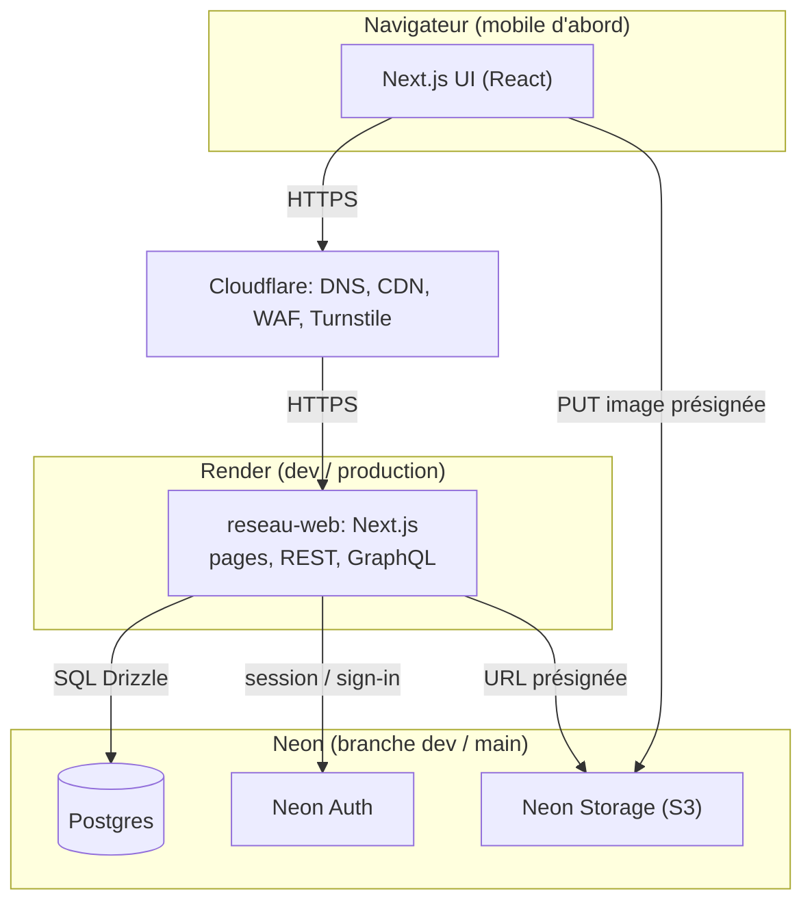
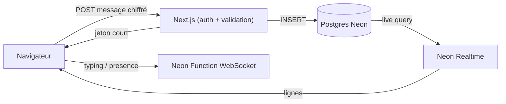
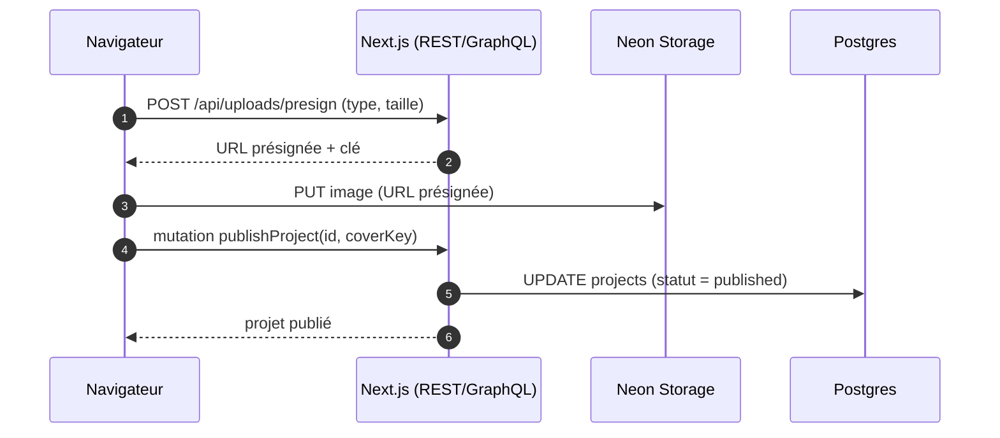

# Architecture

## Vue d'ensemble (V1)



Évolution V2 : **Neon Realtime** pour les lignes live (messages, réactions, accusés,
liste de conversations) et **Neon Functions** pour l'éphémère (saisie, présence).
Aucun service `apps/realtime` n'est créé. La signalisation WebRTC et TURN restent
hors V2 (ADR 0005, révisé par ADR 0008).

### Temps réel V2



- Les écritures ne passent jamais par le WebSocket.
- Une live query est **scellée côté serveur** et filtrée sur les conversations de
  l'utilisateur ; le client ne peut pas modifier le SQL.
- Les événements de saisie/présence sont éphémères, avec TTL ; ils ne sont pas stockés.
- `NEON_REALTIME_SECRET` est serveur uniquement.

## API : qui parle comment
| Domaine | Protocole | Pourquoi |
|---|---|---|
| Projets / posts (liste, détail, création, édition, publication, suppression) | **GraphQL** (`POST /api/graphql`) | Lectures composées (projet + auteur + compétences), évolutif vers le fil |
| Auth | Handler Neon Auth (`/api/auth/[...path]`) | Fourni par le SDK |
| Messagerie : écritures et historique | **REST** (`/api/conversations/*`, `/api/messages/*`) | Écritures autorisées, pagination par curseur |
| Messagerie : flux live | **Neon Realtime** (live query scellée) | Lignes persistées + accusés + réactions |
| Saisie / présence | **Neon Function WebSocket** | Éphémère, TTL court, rien en base |
| Profil, compétences, recherche, upload | **REST** (route handlers) | Opérations simples, cacheables |
| Pages serveur (RSC) | **Appel direct aux cas d'usage** | Jamais d'appel HTTP vers soi-même |

## Couches (dans `apps/web/src`)
```
app/                  Transport : pages, route handlers, GraphQL route. Aucune logique métier.
server/graphql/       Schéma Pothos + résolveurs (appellent application/)
modules/<module>/
  components/         UI propre au module
  application/        Cas d'usage : autorisation + règles métier + orchestration
  data/               Repositories Drizzle (seule couche qui parle SQL)
  index.ts            API publique du module
lib/                  auth.ts, storage.ts, errors.ts, logger.ts, env.ts (validés par Zod)
components/ui/        shadcn/ui (seule source de composants de base)
```
Règle de dépendance (sens unique) : `app → application → data`. `components → schémas Zod` seulement. Un module n'importe un autre module que par son `index.ts`.

Modules V1 : `profiles`, `skills`, `projects`, `search`, `uploads`. (L'auth est dans `lib/auth.ts`.)

## Contrats partagés (`packages/shared`)
Schémas Zod, types, énumérations (`ProofLevel`, `ProjectStatus`) et codes d'erreur. **Contract-first** : le contrat est écrit et fusionné d'abord, ce qui permet au backend et au frontend de travailler en parallèle.

## Gestion des erreurs
Les cas d'usage lèvent des erreurs typées (`NotFound`, `Forbidden`, `Validation`, `Conflict`) définies dans `lib/errors.ts`. REST les traduit en codes HTTP (404, 403, 422, 409), GraphQL en `extensions.code`. Aucune trace d'appel renvoyée au client.

## Séquence : publier un projet avec image (F06)


## Évolutivité sans surconstruction
- Index et pagination par curseur dès la V1 (`data-model.md`).
- Images servies redimensionnées (`next/image`) et mises en cache par Cloudflare.
- Les futurs services lisent la même base via `packages/db`.
