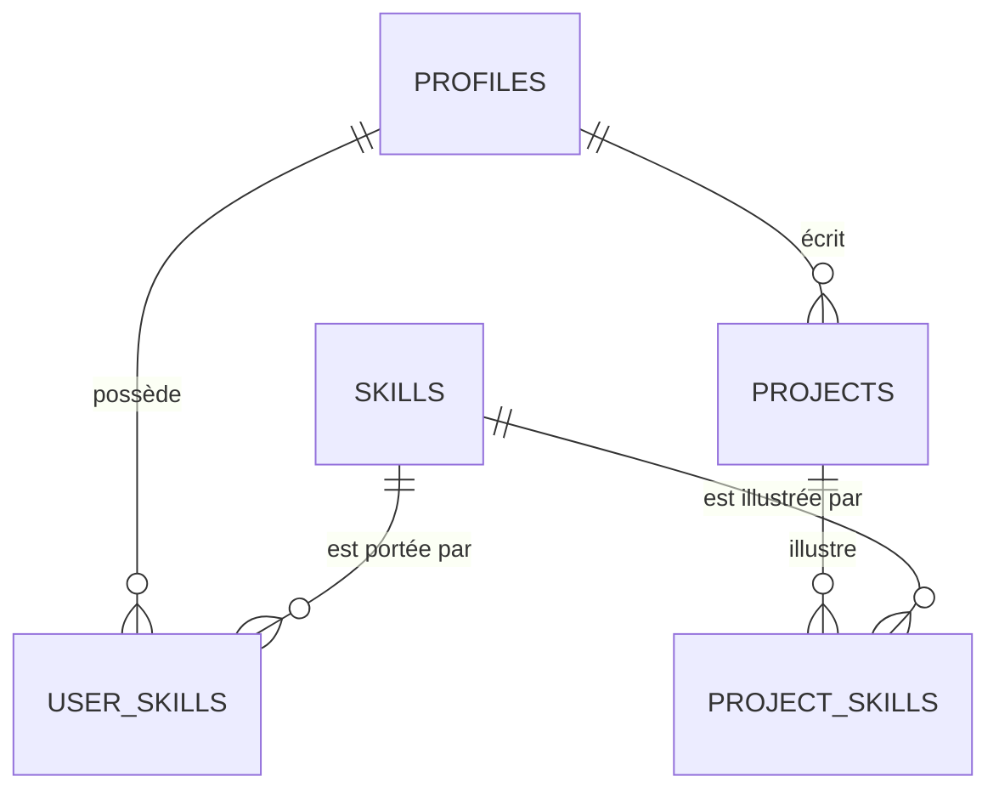

# Modèle de données

SGBD : Postgres (Neon). ORM : Drizzle. Les comptes (e-mail, mot de passe, sessions) sont gérés par **Neon Auth** ; nos tables référencent l'identifiant utilisateur Neon Auth dans `profiles.user_id` (référence logique ; vérifier si une clé étrangère inter-schéma est possible dans la version de Neon Auth utilisée, ADR 0003).

Conventions : tables en `snake_case` pluriel · clés `uuid` (`gen_random_uuid()`) · `created_at`/`updated_at` `timestamptz` · enums Postgres · suppression douce uniquement si la fiche l'exige.

## Tables V1 (migrées)



### `profiles`
| Colonne | Type | Règle |
|---|---|---|
| id | uuid PK | |
| user_id | text, unique, not null | id Neon Auth |
| username | text, unique, not null | 3–30 car., `[a-z0-9_]`, minuscules, **non modifiable en V1** (URL stable, voir F10) |
| display_name | text, not null | 2–60 car. |
| bio | text, null | ≤ 500 car. |
| school_name | text, null | libre en V1 |
| field_of_study | text, null | libre en V1 |
| avatar_key | text, null | clé Neon Storage |
| created_at, updated_at | timestamptz | |

### `skills` (référentiel normalisé)
`id`, `slug` (unique, minuscules sans accents, ex. `react`), `name` (affichage), `created_at`. Création libre normalisée par les utilisateurs en V1 (dédoublonnage par `slug`).

### `user_skills`
`profile_id` FK, `skill_id` FK, `proof_level` enum(`declared`,`demonstrated`) défaut `declared`, `created_at` — PK `(profile_id, skill_id)`. Maximum 30 compétences par profil.

### `projects`
| Colonne | Type | Règle |
|---|---|---|
| id | uuid PK | |
| author_id | uuid FK → profiles | |
| title | text not null | 3–120 car. |
| body | text not null | 1–5000 car., texte brut en V1 |
| cover_key | text null | une image, clé Neon Storage |
| status | enum(`draft`,`published`) | défaut `draft` |
| published_at | timestamptz null | posé à la publication |
| created_at, updated_at | timestamptz | |

### `project_skills`
`project_id` FK (cascade), `skill_id` FK — PK `(project_id, skill_id)`. Maximum 10 par projet.

**Dérivation** : `user_skills.proof_level = 'demonstrated'` ⇔ il existe un projet `published` de ce profil dans `project_skills` pour cette compétence. Recalcul dans le cas d'usage de publication / dépublication / suppression / édition des étiquettes.

## Index V1 (recherche et listes)
```sql
CREATE EXTENSION IF NOT EXISTS pg_trgm;
CREATE EXTENSION IF NOT EXISTS unaccent;

-- Compétences : recherche exacte + tolérance aux fautes (autocomplétion, F09)
CREATE UNIQUE INDEX skills_slug_uq ON skills (slug);
CREATE INDEX skills_name_trgm ON skills USING gin (name gin_trgm_ops);

-- Étudiants par compétence (F09) : jointure et tri par niveau
CREATE INDEX user_skills_skill_idx ON user_skills (skill_id, profile_id);
CREATE INDEX user_skills_profile_idx ON user_skills (profile_id);

-- Projets : liste récente paginée par curseur (F07), par auteur (F08)
CREATE INDEX projects_published_idx ON projects (published_at DESC, id DESC) WHERE status = 'published';
CREATE INDEX projects_author_idx ON projects (author_id, created_at DESC);
CREATE INDEX project_skills_skill_idx ON project_skills (skill_id, project_id);

-- Profils : recherche par nom (optionnelle en V1)
CREATE UNIQUE INDEX profiles_username_uq ON profiles (username);
CREATE INDEX profiles_display_name_trgm ON profiles USING gin (display_name gin_trgm_ops);
```
Les extensions et index GIN s'écrivent dans une migration Drizzle **SQL personnalisée** (`drizzle-kit generate --custom`). Pagination : par curseur `(published_at, id)`, jamais `OFFSET`.

## Tables réservées (documentées, NON migrées en V1)
| Version | Tables |
|---|---|
| V1.5 | `spaces`, `space_access_methods` (type, config JSON, actif), `memberships` (profile, space, rôle, `verification_level`, `verified_via`), `feed_posts` (type texte/image/vidéo, visibilité), `media_assets` (vidéos : statut, durée, poids), `structured_posts` (appris/construit/participé/obtenu), `skill_evidence` (artefact, niveau `verifiable`), `skill_suggestions` (proposée/acceptée/refusée), `cv_documents` (sections JSON, `edited` par section), `portfolios` |
| V2 | `connections`, `conversations`, `messages` (chiffrés : le serveur ne stocke que du chiffré), `device_keys` (clé publique) |
| V3 | `recruiter_searches`, `space_stats`, `resources`, `mentorships` |

Règle : une table n'est créée que dans la version qui l'utilise. Les ajouts futurs doivent être additifs (nouvelles tables, colonnes nullables).

## Convention — appartenance en attente (F15)

F15 (rejoindre un espace) n'ajoute **aucune table ni colonne** : une demande en attente est
une ligne `memberships` avec `verification_level = 'unverified'` et
`verified_via = 'manual_approval'`. L'approbation (F17) ne fait que passer cette même ligne
à `verification_level = 'verified'` ; le journal `space_access_log` enregistre `request`
puis `approve`. Aucune migration n'est donc nécessaire au-delà des tables V1.5 déjà définies
(`spaces`, `space_access_methods`, `memberships`, `space_access_log`).

**Supprimé du cadrage initial** : table `endorsements` (validation par pairs/enseignants).
