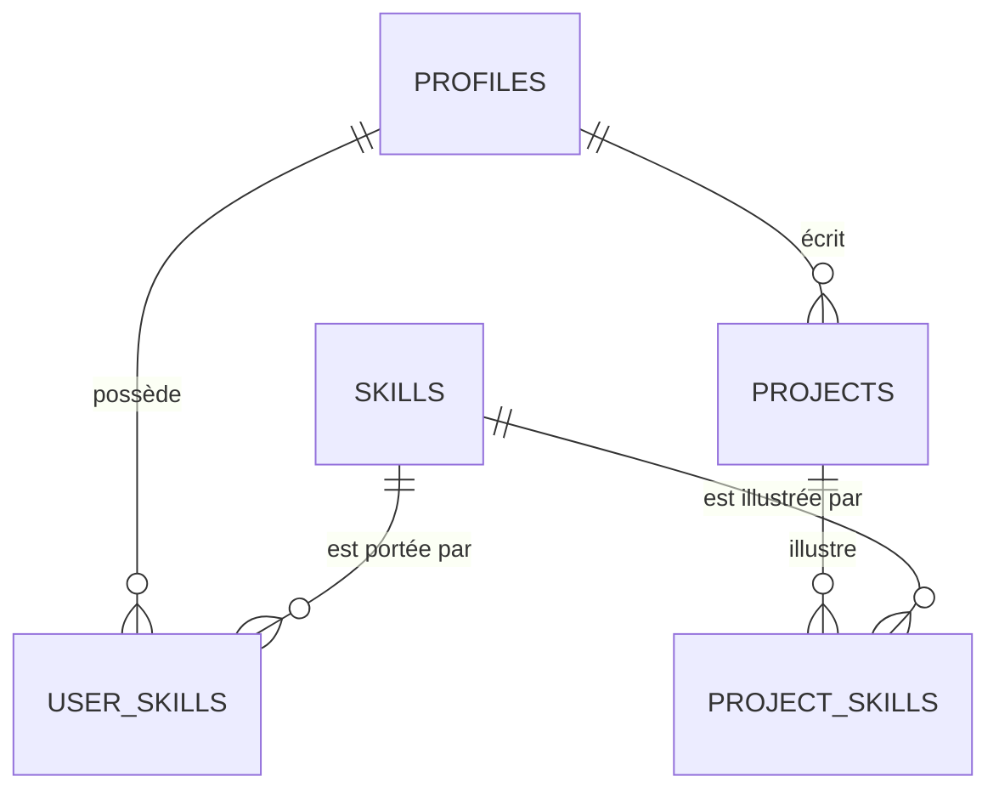

# Modèle de données

SGBD : Postgres (Neon). ORM : Drizzle. Les comptes (e-mail, mot de passe, sessions) sont gérés par **Neon Auth** ; nos tables référencent l'identifiant utilisateur Neon Auth dans `profiles.user_id` (référence logique ; vérifier si une clé étrangère inter-schéma est possible dans la version de Neon Auth utilisée, ADR 0003).

Conventions : tables en `snake_case` pluriel · clés `uuid` (`gen_random_uuid()`) · `created_at`/`updated_at` `timestamptz` · enums Postgres · suppression douce uniquement si la fiche l'exige.

## Tables V1 (migrées)



### `profiles`
| Colonne | Type | Règle |
|---|---|---|
| id | uuid PK | |
| user_id | text, unique, not null | id Neon Auth |
| username | text, unique, not null | 3–30 car., `[a-z0-9_]`, minuscules, **non modifiable en V1** (URL stable, voir F10) |
| display_name | text, not null | 2–60 car. |
| bio | text, null | ≤ 500 car. |
| school_name | text, null | libre en V1 |
| field_of_study | text, null | libre en V1 |
| avatar_key | text, null | clé Neon Storage |
| created_at, updated_at | timestamptz | |

### `skills` (référentiel normalisé)
`id`, `slug` (unique, minuscules sans accents, ex. `react`), `name` (affichage), `created_at`. Création libre normalisée par les utilisateurs en V1 (dédoublonnage par `slug`).

### `user_skills`
`profile_id` FK, `skill_id` FK, `proof_level` enum(`declared`,`demonstrated`) défaut `declared`, `created_at` — PK `(profile_id, skill_id)`. Maximum 30 compétences par profil.

### `projects`
| Colonne | Type | Règle |
|---|---|---|
| id | uuid PK | |
| author_id | uuid FK → profiles | |
| title | text not null | 3–120 car. |
| body | text not null | 1–5000 car., texte brut en V1 |
| cover_key | text null | une image, clé Neon Storage |
| status | enum(`draft`,`published`) | défaut `draft` |
| published_at | timestamptz null | posé à la publication |
| type | enum(`personal`,`team`,`open_source`,`research`,`coursework`) | défaut `personal` (F18) |
| created_at, updated_at | timestamptz | |

### `project_skills`
`project_id` FK (cascade), `skill_id` FK — PK `(project_id, skill_id)`. Maximum 10 par projet.

**Dérivation** : `user_skills.proof_level = 'demonstrated'` ⇔ il existe un projet `published` de ce profil dans `project_skills` pour cette compétence. Recalcul dans le cas d'usage de publication / dépublication / suppression / édition des étiquettes.

## Index V1 (recherche et listes)
```sql
CREATE EXTENSION IF NOT EXISTS pg_trgm;
CREATE EXTENSION IF NOT EXISTS unaccent;

-- Compétences : recherche exacte + tolérance aux fautes (autocomplétion, F09)
CREATE UNIQUE INDEX skills_slug_uq ON skills (slug);
CREATE INDEX skills_name_trgm ON skills USING gin (name gin_trgm_ops);

-- Étudiants par compétence (F09) : jointure et tri par niveau
CREATE INDEX user_skills_skill_idx ON user_skills (skill_id, profile_id);
CREATE INDEX user_skills_profile_idx ON user_skills (profile_id);

-- Projets : liste récente paginée par curseur (F07), par auteur (F08)
CREATE INDEX projects_published_idx ON projects (published_at DESC, id DESC) WHERE status = 'published';
CREATE INDEX projects_author_idx ON projects (author_id, created_at DESC);
CREATE INDEX project_skills_skill_idx ON project_skills (skill_id, project_id);

-- Index partiels par type pour filtres catalogue (F18)
CREATE INDEX projects_published_personal_idx ON projects (published_at DESC, id DESC) WHERE status = 'published' AND type = 'personal';
CREATE INDEX projects_published_team_idx ON projects (published_at DESC, id DESC) WHERE status = 'published' AND type = 'team';
CREATE INDEX projects_published_open_source_idx ON projects (published_at DESC, id DESC) WHERE status = 'published' AND type = 'open_source';
CREATE INDEX projects_published_research_idx ON projects (published_at DESC, id DESC) WHERE status = 'published' AND type = 'research';
CREATE INDEX projects_published_coursework_idx ON projects (published_at DESC, id DESC) WHERE status = 'published' AND type = 'coursework';

-- Recherche texte projet (F18) : trigramme sur titre + body
CREATE INDEX projects_search_trgm ON projects USING gin ((title || ' ' || body) gin_trgm_ops);

-- Profils : recherche par nom (optionnelle en V1)
CREATE UNIQUE INDEX profiles_username_uq ON profiles (username);
CREATE INDEX profiles_display_name_trgm ON profiles USING gin (display_name gin_trgm_ops);
```
Les extensions et index GIN s'écrivent dans une migration Drizzle **SQL personnalisée** (`drizzle-kit generate --custom`). Pagination : par curseur `(published_at, id)`, jamais `OFFSET`.

## Tables réservées (documentées, NON migrées en V1)
| Version | Tables |
|---|---|
| V1.5 | `spaces`, `space_access_methods` (type, config JSON, actif), `memberships` (profile, space, rôle, `verification_level`, `verified_via`), `feed_posts` (type texte/image/vidéo, visibilité), `media_assets` (vidéos : statut, durée, poids), `structured_posts` (appris/construit/participé/obtenu), `skill_evidence` (artefact, niveau `verifiable`), `skill_suggestions` (proposée/acceptée/refusée), `cv_documents` (sections JSON, `edited` par section), `portfolios`, **`project_reactions`, `project_comments`, `project_followers`, `project_updates`** |
| V2 | `connections`, `conversations`, `messages` (chiffrés : le serveur ne stocke que du chiffré), `device_keys` (clé publique) |
| V3 | `recruiter_searches`, `space_stats`, `resources`, `mentorships` |

Règle : une table n'est créée que dans la version qui l'utilise. Les ajouts futurs doivent être additifs (nouvelles tables, colonnes nullables).

## Convention — appartenance en attente (F15)

F15 (rejoindre un espace) n'ajoute **aucune table ni colonne** : une demande en attente est
une ligne `memberships` avec `verification_level = 'unverified'` et
`verified_via = 'manual_approval'`. L'approbation (F17) ne fait que passer cette même ligne
à `verification_level = 'verified'` ; le journal `space_access_log` enregistre `request`
puis `approve`. Aucune migration n'est donc nécessaire au-delà des tables V1.5 déjà définies
(`spaces`, `space_access_methods`, `memberships`, `space_access_log`).

## Table V1.5 — `auth_otp_audit` (journal des envois OTP)

Trace **qu'un code OTP a été envoyé** (option A de la console admin). **Aucun code OTP
n'est stocké** : Neon Auth (Managed Better Auth) génère et envoie le code, l'app ne le
reçoit jamais.

| Colonne | Type | Règle |
|---|---|---|
| id | uuid PK | `gen_random_uuid()` |
| email | text, not null | adresse normalisée (minuscules), 3–254 car. |
| type | text, not null | `email-verification` \| `forgot-password` (CHECK) |
| outcome | text, not null | `sent` \| `failed` (CHECK) |
| error_code | text, null | code d'erreur Bootstrap/Better Auth éventuel |
| created_at | timestamptz, not null | `now()` |

Index : `auth_otp_audit_created_idx (created_at DESC, id DESC)` (liste bornée admin),
`auth_otp_audit_email_idx (email)`. Migration additive `0008_auth_otp_audit.sql`.

## Tables V1.5 — Fonctionnalités sociales projets (F18/F19/F20)

### `project_reactions` (F19 — réactions)
Un membre = 1 réaction par type par projet (toggle on/off).

| Colonne | Type | Règle |
|---|---|---|
| project_id | uuid FK → projects | PK partielle, cascade delete |
| profile_id | uuid FK → profiles | PK partielle, cascade delete |
| type | enum(`like`,`celebrate`,`insight`,`curious`) | PK partielle |
| created_at | timestamptz | défaut `now()` |

PK : `(project_id, profile_id, type)`. Index : `project_reactions_project_idx`, `project_reactions_profile_idx`.

### `project_comments` (F19 — commentaires imbriqués)
Commentaires et réponses sur un projet publié. `parent_id` NULL = commentaire racine, non-NULL = réponse.

| Colonne | Type | Règle |
|---|---|---|
| id | uuid PK | `gen_random_uuid()` |
| project_id | uuid FK → projects | cascade delete |
| parent_id | uuid FK → project_comments | cascade delete, NULL pour racine |
| author_id | uuid FK → profiles | cascade delete |
| body | text not null | 1–1000 car., texte brut |
| created_at, updated_at | timestamptz | défaut `now()` |

Index : `project_comments_project_idx (project_id, created_at DESC, id DESC)`, `project_comments_parent_idx (parent_id)`.

### `project_followers` (F19 — suivi)
Membres suivant un projet pour notifications temps réel.

| Colonne | Type | Règle |
|---|---|---|
| project_id | uuid FK → projects | PK partielle, cascade delete |
| profile_id | uuid FK → profiles | PK partielle, cascade delete |
| created_at | timestamptz | défaut `now()` |

PK : `(project_id, profile_id)`. Index : `project_followers_profile_idx`.

### `project_updates` (F20 — évolutions/updates)
Mises à jour d'avancement créées par l'auteur du projet uniquement.

| Colonne | Type | Règle |
|---|---|---|
| id | uuid PK | `gen_random_uuid()` |
| project_id | uuid FK → projects | cascade delete |
| author_id | uuid FK → profiles | cascade delete |
| body | text not null | 1–5000 car., texte brut |
| image_key | text null | clé Neon Storage (bucket `projet`) |
| created_at, updated_at | timestamptz | défaut `now()` |

Index : `project_updates_project_idx (project_id, created_at DESC, id DESC)`, `project_updates_author_idx (author_id)`.

**Supprimé du cadrage initial** : table `endorsements` (validation par pairs/enseignants).

## Tables V2 — messagerie chiffrée (planifiées)

> Migration **additive** uniquement. Aucune colonne existante n'est renommée ni
> supprimée. Les contenus (`ciphertext`, réactions, clés enveloppées) sont opaques
> pour le serveur.

### `conversations`

| Colonne | Type | Règle |
|---|---|---|
| id | uuid PK | `gen_random_uuid()` |
| kind | enum(`direct`,`group`) | défaut `direct`, `group` non exposé en V2 |
| direct_key | text unique, null | deux `profile_id` triés, ex. `uuidA:uuidB` ; NULL pour groupe |
| created_by | uuid FK → profiles | auteur de la conversation |
| last_message_at | timestamptz, null | mis à jour à chaque message |
| created_at, updated_at | timestamptz | défaut `now()` |

Index : `conversations_last_message_idx (last_message_at DESC, id DESC)`.

### `conversation_participants`

| Colonne | Type | Règle |
|---|---|---|
| conversation_id | uuid FK → conversations | PK partielle, cascade |
| profile_id | uuid FK → profiles | PK partielle, cascade |
| role | enum(`member`,`owner`) | défaut `member` |
| last_read_at | timestamptz, null | curseur de lecture |
| joined_at | timestamptz | défaut `now()` |

PK : `(conversation_id, profile_id)`. Index : `conversation_participants_profile_idx (profile_id, conversation_id)`.

### `messages`

| Colonne | Type | Règle |
|---|---|---|
| id | uuid PK | `gen_random_uuid()` |
| conversation_id | uuid FK → conversations | cascade |
| sender_id | uuid FK → profiles | cascade |
| client_id | uuid, unique | idempotence d'envoi |
| ciphertext | text, not null | base64, contenu chiffré |
| iv | text, not null | nonce AES-GCM (12 octets, base64) |
| key_version | integer, not null | version de la clé de conversation |
| sender_key_id | text, not null | clé publique utilisée |
| created_at | timestamptz | défaut `now()` |
| edited_at, deleted_at | timestamptz, null | édition/suppression douce |

Index : `messages_conversation_idx (conversation_id, created_at DESC, id DESC)`.

### `message_reactions`

| Colonne | Type | Règle |
|---|---|---|
| id | uuid PK | `gen_random_uuid()` |
| message_id | uuid FK → messages | cascade |
| profile_id | uuid FK → profiles | cascade |
| ciphertext | text, not null | emoji chiffré côté client |
| iv | text, not null | nonce AES-GCM |
| key_version | integer, not null | |
| created_at, updated_at | timestamptz | défaut `now()` |

Unique : `(message_id, profile_id)` — une réaction par personne et par message.

### `message_receipts`

| Colonne | Type | Règle |
|---|---|---|
| message_id | uuid FK → messages | PK partielle, cascade |
| profile_id | uuid FK → profiles | PK partielle, cascade |
| delivered_at | timestamptz, null | |
| read_at | timestamptz, null | |

PK : `(message_id, profile_id)`. Index : `message_receipts_profile_idx (profile_id, read_at)`.

### `profile_keys`

| Colonne | Type | Règle |
|---|---|---|
| profile_id | uuid FK → profiles | PK, cascade |
| key_id | text, not null | identifiant de clé |
| public_key_jwk | jsonb, not null | clé **publique** ECDH P-256 |
| algorithm | text, not null | `ECDH-P256` |
| created_at, rotated_at | timestamptz | |

Aucune clé privée, aucun secret.

### `conversation_keys`

| Colonne | Type | Règle |
|---|---|---|
| conversation_id | uuid FK → conversations | PK partielle, cascade |
| profile_id | uuid FK → profiles | PK partielle, cascade |
| key_id | text | PK partielle |
| wrapped_key | text, not null | clé de conversation enveloppée (opaque) |
| iv | text, not null | nonce de l'enveloppe |
| algorithm | text, not null | `AES-256-GCM` |
| created_at | timestamptz | défaut `now()` |

PK : `(conversation_id, profile_id, key_id)`. Le serveur ne peut pas déballer ces clés.

### Galerie d'images (posts et projets)

- `post_images` : `id`, `post_id` FK cascade, `key`, `position` smallint `0..4`,
  `alt` null, `created_at`. Unique `(post_id, position)`.
- `project_images` : même forme avec `project_id`.
- `position = 0` est la **couverture** ; maximum 5 images. Les anciennes colonnes
  `image_key` / `cover_key` restent lisibles pendant la transition, puis sont
  ignorées par les nouveaux parcours.

